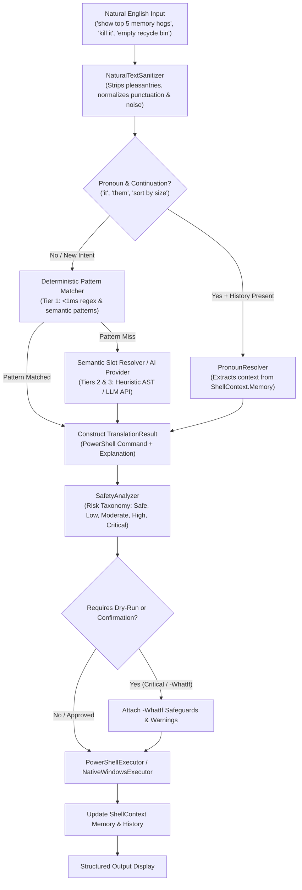

# Sagar Shell — Natural Language Windows Engine

**Sagar Shell** is a next-generation Windows PowerShell alternative that enables users to execute operating system commands using natural English instead of cryptic syntax.

---

## Architecture Overview



---

## Key Capabilities & Intelligence Tiers

### 1. Multi-Tier Resolution Pipeline
- **Tier 1 (Deterministic Pattern Matchers - `<1ms`, Offline)**:
  - **File System**: Listing with filters, finding by extension, content search (`Select-String`), file/folder creation, head/tail reading, deletion, moving/renaming, zipping/unzipping, folder size measurement, empty recycle bin.
  - **Process Management**: Top CPU/RAM consumers, finding processes by name/PID, killing by name/PID, and discovering/terminating processes occupying specific TCP ports.
  - **Networking**: Local IPv4 adapter discovery, public WAN IP query, pinging with count, TCP socket reachability test (`Test-NetConnection`), DNS flushing, listening ports, saved Wi-Fi password recovery.
  - **System Information & Power**: RAM free/used stats, CPU load, system uptime calculation (universal across PowerShell 5.1 & Core), battery percentage, disk partition space, environment variables, sleep, lock, restart, and timed shutdown.
  - **Windows Services**: Service status queries, starting, stopping, and restarting services with elevation detection.
  - **Git Operations**: Status, staging & committing with message, branch creation/switching, commit history graph, stash/pop, push/pull, undoing commits.
  - **Navigation & Windowing**: Intelligent `cd` alias resolution (`desktop`, `downloads`, `~`, `..`, `go back`), wallpaper updating via Win32 `SystemParametersInfo`, clipboard inspection and copying, browser search launch.

- **Tier 2 (Parametric Slot-Filling & Heuristic AST Engine)**:
  - Decomposes unknown verbs, nouns, target paths, relative temporal queries (`"modified in the last 2 hours"`, `"older than 30 days"`), and human file sizes (`"> 100MB"`, `"< 50KB"`, `"empty"`).

- **Tier 3 (Pluggable LLM Provider)**:
  - Out-of-the-box support for OpenAI, local Ollama (`localhost:11434`), and LM Studio with structured JSON output and safety boundary constraints.

---

### 2. Contextual Dialogue & Pronoun Intelligence (`PronounResolver`)
Maintains conversational continuity across shell operations:
- **Pipeline Continuations**:
  - `User > list all pdf files in downloads`
  - `User > sort them by size` -> automatically generates `Get-ChildItem -Path "$HOME\Downloads" -Filter '*.pdf' | Sort-Object Length -Descending`
  - `User > show first 5` -> appends `| Select-Object -First 5`
- **Anaphoric Process Termination**:
  - `User > what is using port 3000` -> identifies PID `14290`
  - `User > kill it` -> generates `Stop-Process -Id 14290 -Force`
- **Context Memory**:
  - Remembers last referenced files, folders, processes, PIDs, ports, services, URLs, and git branches in `ShellContext.Memory`.

---

### 3. Risk & Safety Guardrails (`SafetyAnalyzer`)

| Risk Level | Impact | Examples | Behavior |
| :--- | :--- | :--- | :--- |
| **`Safe`** | Read-only inspection / queries | `Get-ChildItem`, `Get-Process`, `ipconfig`, `system uptime` | Auto-executed |
| **`Low`** | UI state & directory navigation | `Set-Location`, `Clear-Host`, `Set-Clipboard` | Auto-executed |
| **`Moderate`** | Non-destructive creations/copies | `New-Item`, `Copy-Item`, `git commit`, `Start-Process` | Auto-executed with notice |
| **`High`** | Terminations / modifications | `Stop-Process`, `Stop-Service`, `git reset`, `Move-Item` | Highlighted warning |
| **`Critical`** | Destructive / irreversible actions | `Remove-Item -Recurse`, `Clear-RecycleBin`, `shutdown` | Requires prompt confirmation / Dry-Run |

---

## Project Structure

```
Sagar Shell/
├── SagarShell.Engine/                # Core C# / .NET 10 Class Library
│   ├── Models/                      # RiskLevel, ShellContext, TranslationResult, IntentCategory
│   ├── Intelligence/                # Translation orchestrator, pronoun resolver, safety analyzer
│   │   ├── Patterns/                # Domain-specific pattern matchers (FileSystem, Process, Network, etc.)
│   │   └── AIProviders/             # Pluggable LLM & heuristic fallback providers
│   ├── Execution/                   # PowerShellExecutor & NativeWindowsExecutor
│   └── Utilities/                   # NaturalPathResolver, NaturalSizeParser, NaturalTimeParser, Sanitizer
├── SagarShell.Engine.Tests/          # 51 Unit, Integration & End-to-End Tests (xUnit)
└── SagarShell.Engine.Cli/            # Interactive REPL CLI with colorized risk badges & execution
```

---

## Running the Engine & Tests

### Run the Interactive Shell CLI
```powershell
dotnet run --project SagarShell.Engine.Cli
```

### Run the Test Suite
```powershell
dotnet test
```
*(All 51 tests pass with 100% success rate)*
